# ReLoop Technologies Mobile App

ReLoop is an Android recycling services app built in Kotlin for the ReLoop Technologies SA WIL 2026 project. It connects residents with recycling pickup services and provides recycling guidance, scan demonstrations, rewards, and notifications.

## Features

- Email and password registration, sign in, Google sign in, and password reset
- User profiles and a home dashboard
- Recycling pickup scheduling, pickup history, and pickup status updates
- Recycling guidance and sorting information
- Camera capture with a **demonstration waste classification result**
- Reward balance, points history, voucher catalogue, and redemption flow
- In-app and push notifications
- Role-aware resident, collection agent, and administrator behavior

> **Classification note:** the current scan result is a prototype. It displays a fixed Plastic Bottle label, confidence score, and estimated weight; the app does not currently run an image classification model.

## App screenshots

| | |
| --- | --- |
| 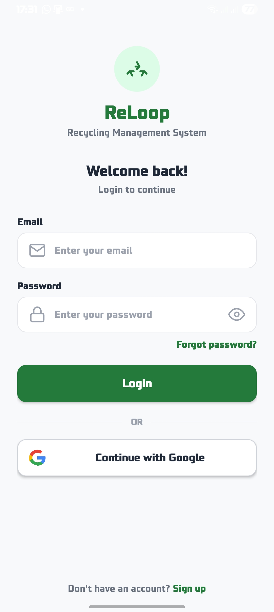<br><sub>Sign in with email and password or continue with Google.</sub> | 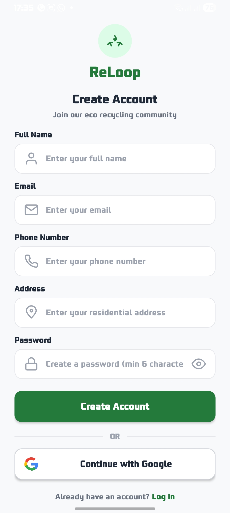<br><sub>Create an account with contact and address details.</sub> |
| 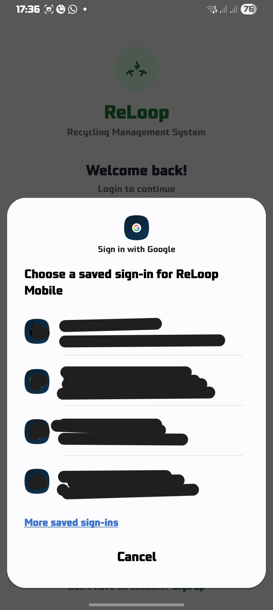<br><sub>Choose a saved Google account for sign-in.</sub> | 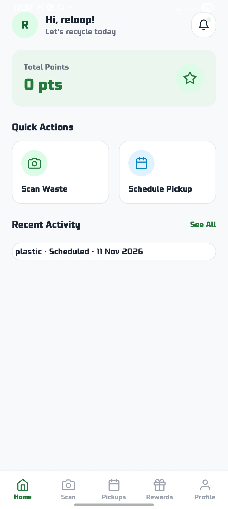<br><sub>See points, recent activity, and quick actions.</sub> |
| 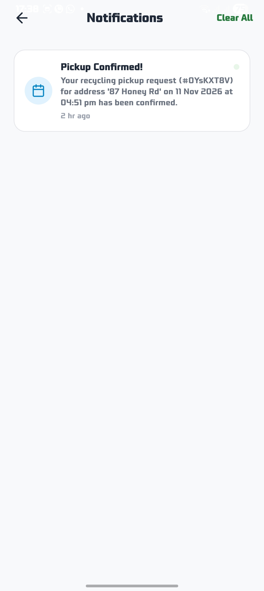<br><sub>View pickup confirmations and other updates.</sub> | 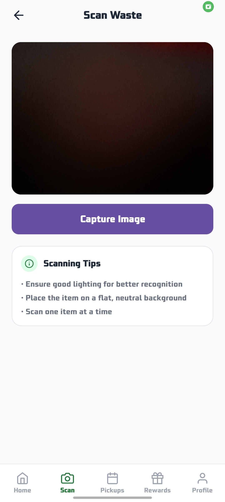<br><sub>Capture a waste image and review scanning tips.</sub> |
| 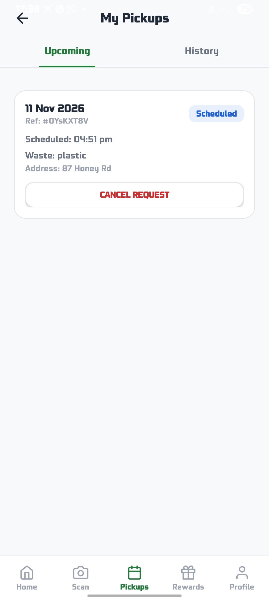<br><sub>Track an upcoming pickup and its status.</sub> | 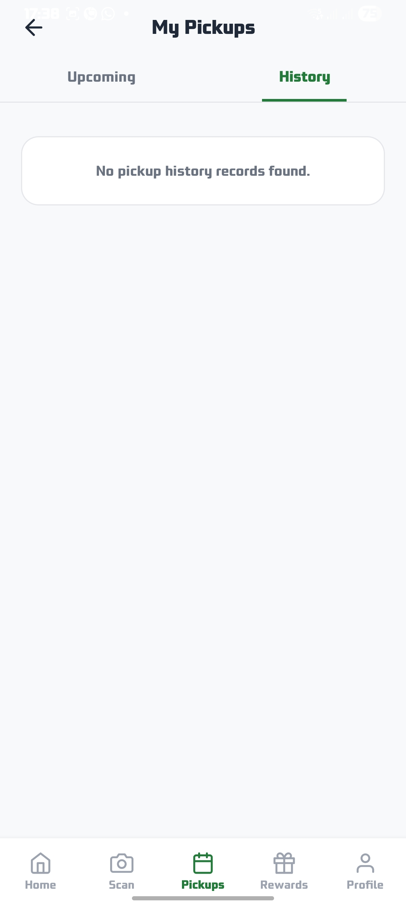<br><sub>Review completed and past pickup requests.</sub> |
| 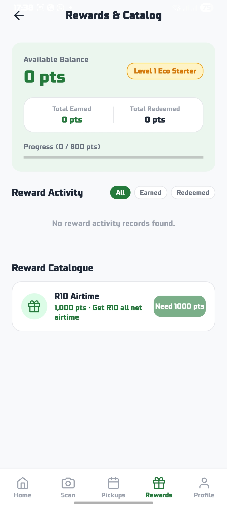<br><sub>Check the points balance and available rewards.</sub> | 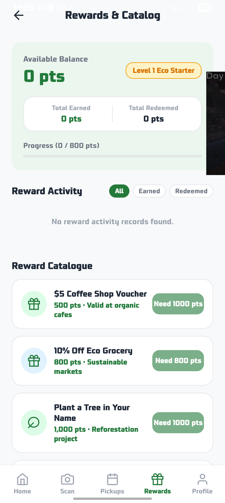<br><sub>Explore reward activity and catalogue entries.</sub> |
| 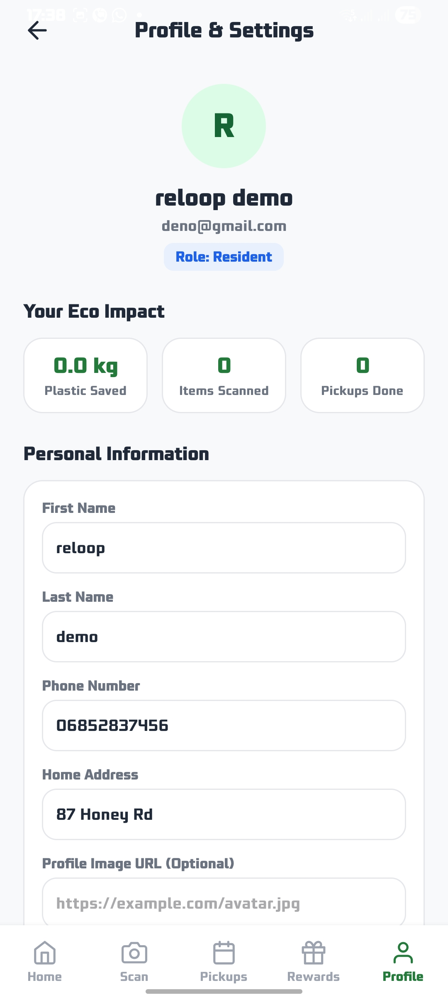<br><sub>View personal information and eco impact.</sub> | 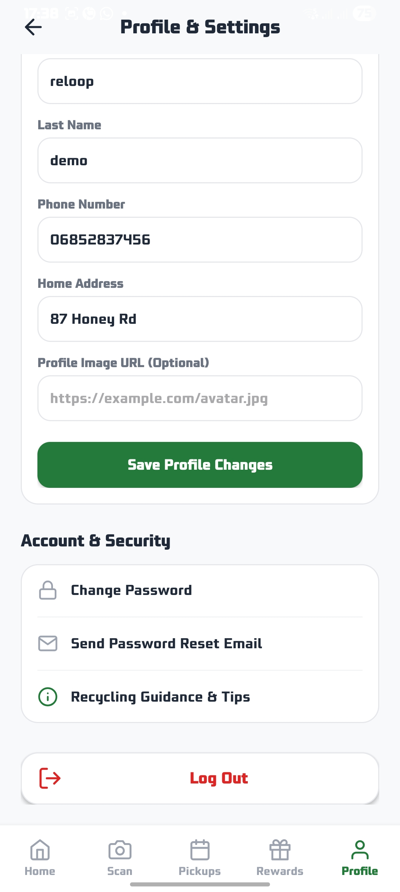<br><sub>Save profile changes and access account settings.</sub> |

## Demo video

[Watch the app walkthrough](assets/az_recorder_20261110_181253.mp4)

## Technology

- Kotlin and Android Views/XML
- Android Gradle Plugin and Gradle Wrapper
- Firebase Authentication
- Cloud Firestore
- Firebase Cloud Messaging
- CameraX
- JUnit 4 for local unit tests

## Requirements

- Android Studio with Android SDK 37 installed
- Java 21 (the Gradle daemon toolchain is configured in `gradle/gradle-daemon-jvm.properties`)
- A Firebase project configured for this app

The app supports Android 7.0 (API 24) and later. It uses application ID `com.example.reloop_technologies_mobile_app`.

## Firebase setup

1. Create or select a Firebase project and add an Android app with the application ID above.
2. Download the generated `google-services.json` into the `app/` directory. This file is intentionally ignored by Git.
3. Enable Email/Password and Google providers in Firebase Authentication. Configure the Google sign-in SHA fingerprints for your development and release signing keys.
4. Enable Cloud Firestore and Cloud Messaging.
5. Review and deploy the Firestore rules in [`firestore.rules`](firestore.rules) to the same Firebase project.

The app uses Firebase Authentication for sessions and Firestore for profiles, pickups, rewards, scan records, guidance, and notifications. Firestore persistence is enabled; the app also has limited local profile and reward-balance caches. Not every feature is available offline.

## Build and run

Open the repository in Android Studio, allow Gradle sync to finish, configure Firebase as described above, then run the `app` configuration on an emulator or Android device.

From Windows PowerShell, run the local unit tests with:

```powershell
.\gradlew.bat testDebugUnitTest
```

To assemble a debug APK:

```powershell
.\gradlew.bat assembleDebug
```

The unit tests cover data models, profile mapping, result states, role parsing, and business rules. They do not require a Firebase connection. The instrumented test source set is under `app/src/androidTest/`.

## Project structure

```text
app/src/main/java/com/example/reloop_technologies_mobile_app/
├── backend/
│   ├── models/       Firestore data models and domain rules
│   ├── repositories/ Firestore-backed feature repositories
│   └── services/    Firebase authentication, Firestore, and messaging
├── database/        Local user profile storage
└── ui/              Android activities and view helpers

app/src/test/        Local JVM unit tests
app/src/androidTest/  Android instrumented tests
firestore.rules      Firestore access rules
```

Repositories return `ResultState` values (`Loading`, `Success`, or `Error`) to keep asynchronous operation state consistent across the UI.

## Firestore data model

Firestore document IDs are used as record IDs where applicable. Fields whose Kotlin model type is `Long` store epoch milliseconds.

| Collection | Purpose | Key fields |
| --- | --- | --- |
| `users` | User profile and role | `firstName`, `lastName`, `email`, `role`, `isActive` |
| `agents` | Collection agent details | `userId`, `contactNumber`, `assignedZone`, `isAvailable` |
| `pickups` | Pickup requests and status | `userId`, `agentId`, `scheduledDate`, `wasteTypes`, `status`, `address` |
| `rewards` | Per-user points account | `pointsBalance`, `totalEarned`, `totalRedeemed` |
| `rewardItems` | Redeemable catalogue | `itemName`, `pointsCost`, `isActive`, `stockQuantity` |
| `redemptionLogs` | Voucher redemption records | `userId`, `rewardItemId`, `pointsUsed`, `voucherCode`, `status` |
| `pointsTransactions` | Points activity history | `userId`, `transactionType`, `points`, `relatedId` |
| `wasteLogs` | Saved scan results | `userId`, `wasteCategoryId`, `weightKg`, `modelLabel`, `confidenceScore` |
| `wasteCategories` | Waste category metadata | `categoryName`, `description`, `modelLabel`, `isActive` |
| `guidanceContent` | Recycling instructions | `wasteCategoryId`, `title`, `content`, `isActive` |
| `notifications` | User notifications | `userId`, `title`, `message`, `type`, `isRead` |

## Security and production status

Firestore rules restrict profile role changes and pickup status updates. Reward balances and points transactions are currently written by the mobile client, so they are not protected against a modified client. Before using rewards as a production incentive or anything with monetary value, move balance changes and redemptions to trusted server-side code and enforce the ledger there.

## Team

The project is maintained by The Avengers team for the 2026 Work-Integrated Learning project.

| GitHub | Name |
| --- | --- |
| [sibongiseni-ngwamba](https://github.com/sibongiseni-ngwamba) | Sibongiseni Ngwamaba |
| [Globoysosa](https://github.com/Globoysosa) | Thokozani Masondo |
| [tirisanomolaolwe-byte](https://github.com/tirisanomolaolwe-byte) | Tirisano Molaolwe |
| [Katleho-1](https://github.com/Katleho-1) | Katleho Kwakwari |
| [st10366193](https://github.com/st10366193) | Katlego Makhuba |
